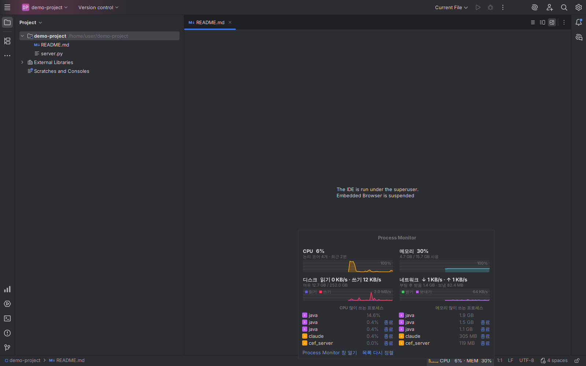
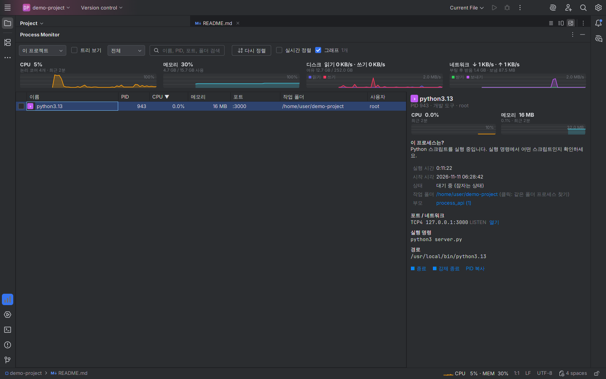
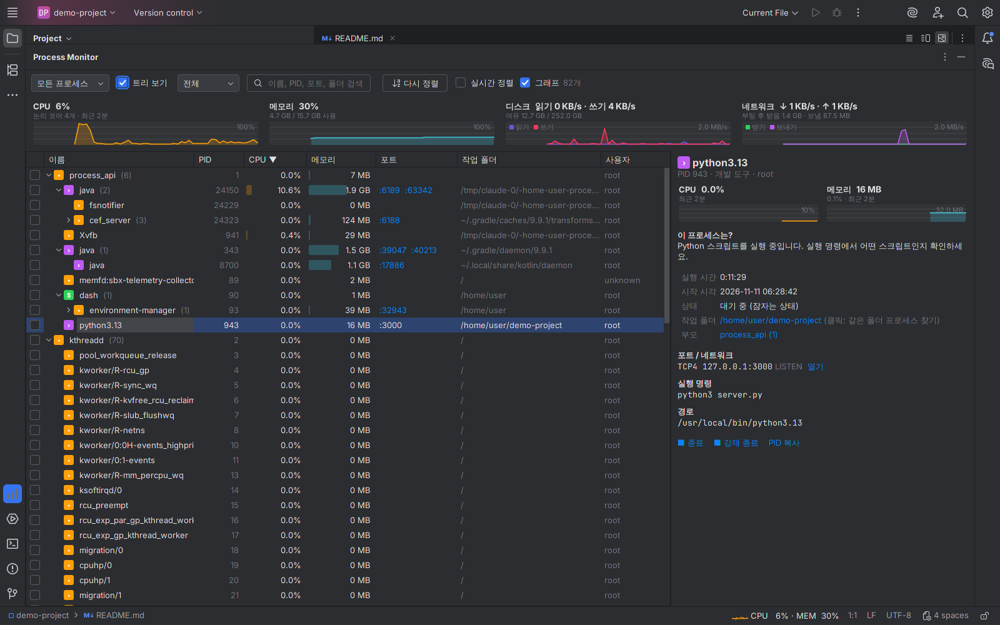
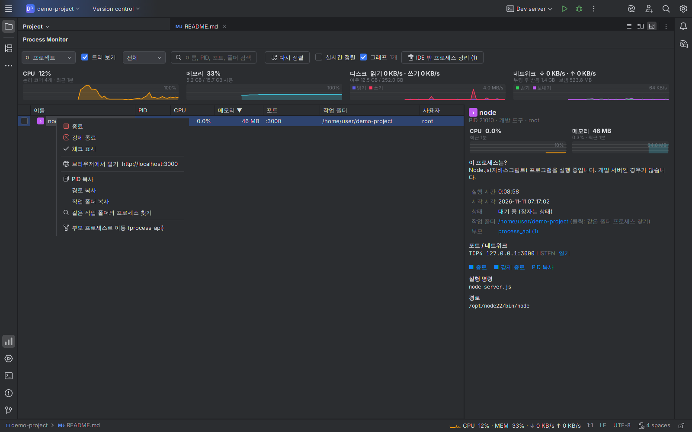
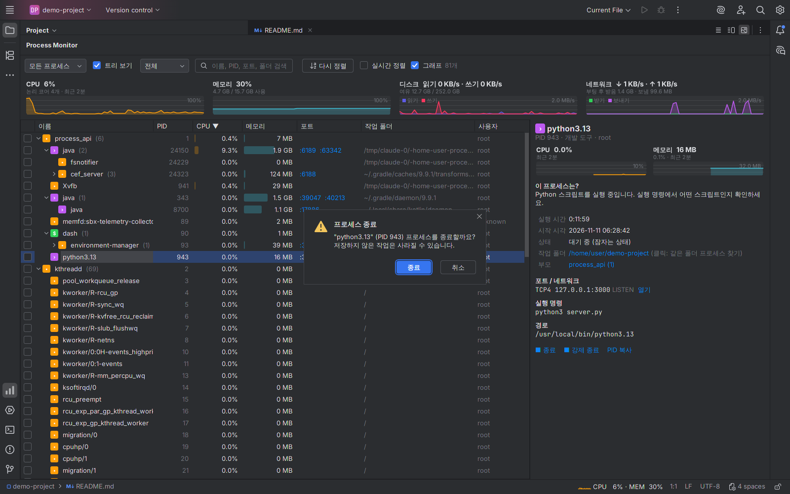
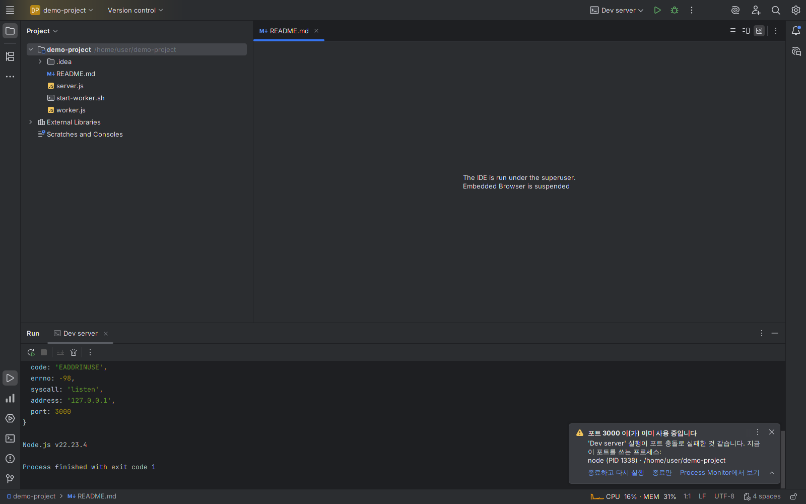
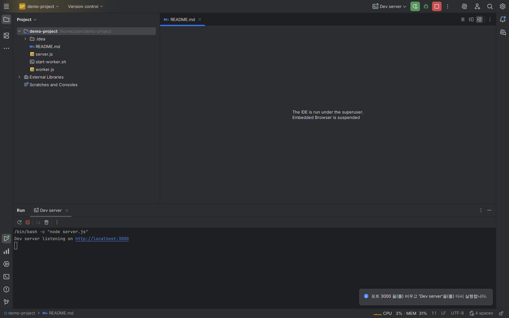
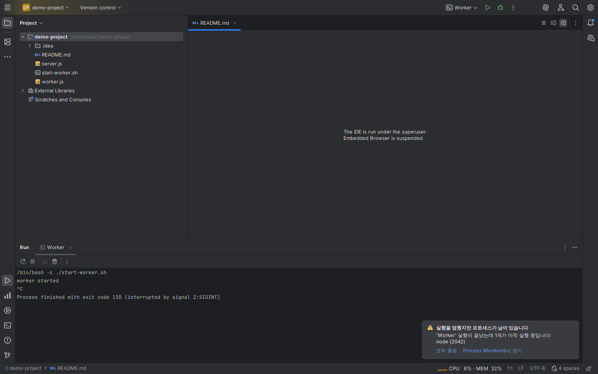
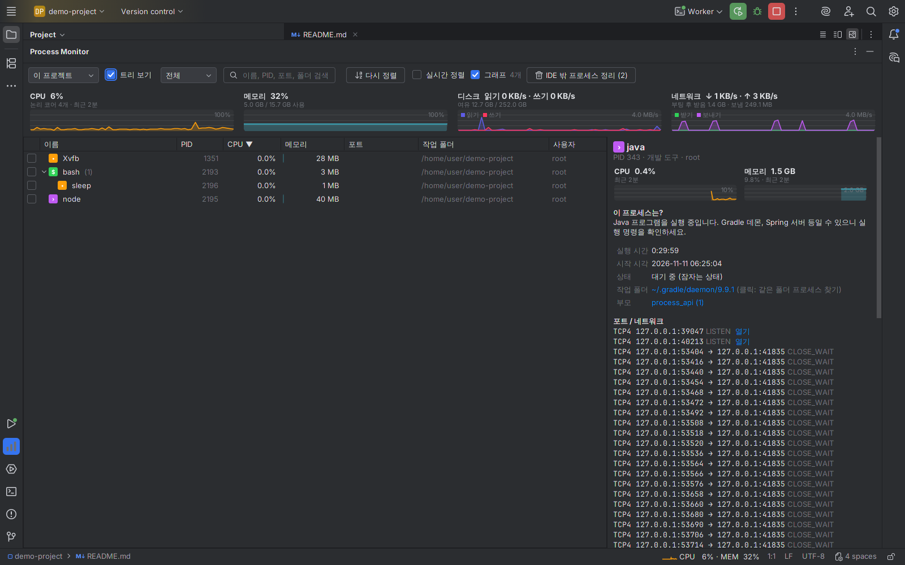
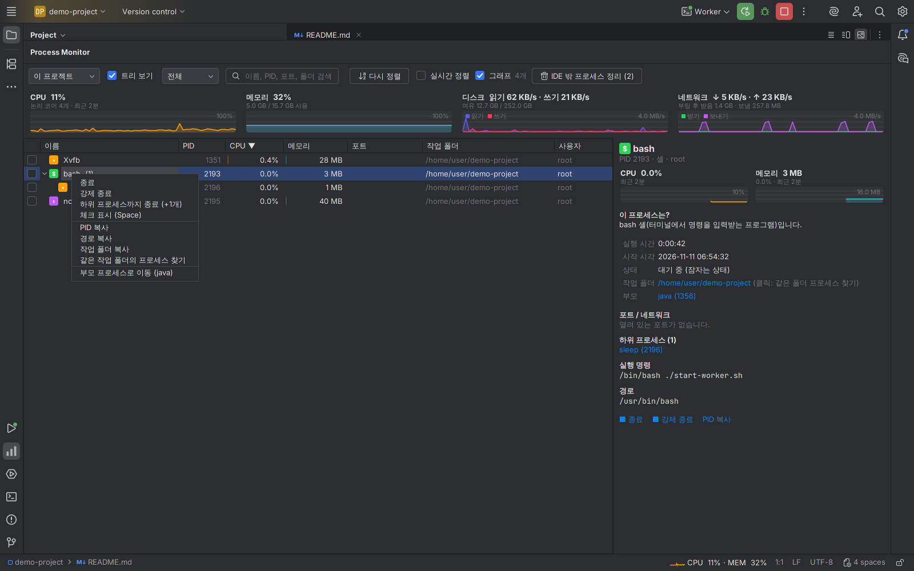

# Process Monitor (IntelliJ 플러그인)

IDE를 떠나지 않고 **실행 중인 프로세스, 포트, CPU·메모리·디스크·네트워크 사용량**을 보고, 필요하면 바로 종료할 수 있는 IntelliJ 플랫폼 플러그인입니다.
macOS · Windows · Linux에서 동작하며, IntelliJ IDEA 2024.2 이상(그리고 같은 플랫폼의 WebStorm, PyCharm, GoLand 등)을 지원합니다.

## 스크린샷

실제 IntelliJ IDEA 2025.2(Community)에 설치해서 찍은 화면입니다.

| 상태 표시줄 팝업 | "이 프로젝트" 보기 + 상세 패널 |
|---|---|
|  |  |

| 트리 보기 | 우클릭 메뉴 | 종료 확인 |
|---|---|---|
|  |  |  |

### Run 감시: 포트 충돌 · 남은 프로세스

| ① Run이 포트 충돌로 실패 → 누가 쓰는지 알림 | ② [종료하고 다시 실행] → 바로 재실행 |
|---|---|
|  |  |

| ③ Run을 멈췄는데 프로세스가 남음 → [모두 종료] | ④ "이 프로젝트": IDE 밖 프로세스 정리 | ⑤ 하위 프로세스까지 종료 |
|---|---|---|
|  |  |  |

## 호환성 검사 결과

JetBrains Plugin Verifier로 검사했습니다. 경고 없이 모두 **Compatible**입니다.

| IDE | 빌드 | 결과 |
|---|---|---|
| IntelliJ IDEA Community 2024.2.5 | 242.24807.4 | Compatible |
| IntelliJ IDEA Community 2025.2.6.4 | 252.28539.149 | Compatible |
| IntelliJ IDEA 2026.3 | 263.7307.200 | Compatible |

GitHub Actions에서 **Ubuntu · macOS · Windows** 세 OS 모두 빌드와 테스트(수집기, 포트 충돌 문구 인식, 프로세스 트리 종료, 화면 렌더링)를 통과합니다.

## 기능

### 상태 표시줄 위젯 (IDE 오른쪽 아래)
- 작은 CPU 그래프와 `CPU 23% · MEM 61%`를 항상 표시
- 클릭하면 팝업:
  - CPU / 메모리 / 디스크(읽기·쓰기) / 네트워크(받기·보내기) 그래프 (최근 2분)
  - CPU·메모리를 많이 쓰는 프로세스 상위 5개와 **종료** 버튼 (팝업이 열려 있는 동안 순서 고정)
  - "Process Monitor 창 열기"
- 숨기려면 상태 표시줄을 우클릭해서 "Process Monitor (CPU·메모리)"를 끄면 됩니다.

### Process Monitor 도구 창 (아래쪽 패널)
- **보기 범위**: 내 프로세스 / **이 프로젝트**(작업 폴더가 현재 프로젝트 안에 있는 프로세스) / 모든 프로세스 / 포트 사용 중 / CPU 사용 중
- **목록 / 트리 보기**: 부모-자식 관계를 펼치고 접기
- **검색**: 전체 · 이름·PID · 작업 폴더(`~/projects/app` 형식 가능) · 포트 · 실행 경로
- **순서 고정**: 값이 바뀌어도 행이 움직이지 않음. 열 제목 클릭 / "다시 정렬" 때만 재정렬 ("실시간 정렬"로 끌 수 있음)
- **다중 선택 종료**: 체크박스(또는 Space) → "체크한 항목 종료 / 강제 종료"
- **우클릭 메뉴**: 종료, 강제 종료, PID·경로·작업 폴더 복사, 같은 작업 폴더의 프로세스 찾기, `http://localhost:포트` 브라우저에서 열기, 부모 프로세스로 이동
- **상세 패널**: 이 프로세스가 무엇인지(한국어 설명), CPU·메모리 추이 그래프, 열린 포트와 네트워크 연결, 실행 명령, 경로, 하위 프로세스
- 단축키: `↑↓` 이동, `Space` 체크, `Delete` 선택 항목 종료

### Run/Debug 감시
- **포트 충돌 감지**: Run 로그에 "포트가 이미 사용 중" 오류가 나오면(Spring Boot, Node.js, Go, uvicorn, Rails/Puma, create-react-app, Java `BindException`) 그 포트를 쓰는 프로세스를 알려주고 **[종료하고 다시 실행] / [종료만] / [Process Monitor에서 보기]** 버튼을 제공합니다. 정상 종료에 응답하지 않으면 강제 종료 후 포트가 비워진 것을 확인하고 다시 실행합니다.
- **남은 프로세스 알림**: Run을 멈춘 뒤에도 하위 프로세스나, 실행 중에 이 프로젝트 폴더에서 분리돼 나간 프로세스가 남아 있으면 알려주고 **[모두 종료]**를 제공합니다.
- **하위 프로세스까지 종료**: 우클릭 메뉴 / 알림 / 정리 버튼은 자식 프로세스부터 함께 종료합니다.
- **IDE 밖 프로세스 정리**: "이 프로젝트" 보기에서, 프로젝트 폴더에서 돌고 있지만 IDE(Run·터미널)와 연결되지 않은 프로세스를 한 번에 정리합니다.

> 지금 사용 중인 IDE 자신과 PID 0/1은 실수로 종료하지 않도록 막혀 있습니다.
> 다른 사용자/시스템 프로세스는 운영체제 권한 때문에 작업 폴더·포트가 보이지 않거나 종료되지 않을 수 있습니다.

## 설치

1. 플러그인 파일(`process-monitor-intellij-1.0.0.zip`)을 준비합니다.
   - **GitHub에서 받기**: 저장소의 **Actions** 탭 → 최신 "Build plugin" 실행 → 아래쪽 **Artifacts**의 `process-monitor-plugin` 다운로드 (압축을 한 번 풀면 안쪽에 플러그인 zip이 있습니다)
   - **직접 빌드**: 아래 "개발" 참고
2. IntelliJ에서 **Settings(설정) → Plugins → ⚙ → Install Plugin from Disk…** → zip 파일 선택 (zip을 풀지 말고 그대로 선택)
3. IDE를 재시작하라고 하면 재시작합니다.
4. 오른쪽 아래 상태 표시줄의 `CPU … · MEM …`을 누르거나, **View → Tool Windows → Process Monitor**를 엽니다.

## 개발

필요: JDK 21 (Gradle은 래퍼가 자동으로 받습니다)

```bash
./gradlew buildPlugin     # build/distributions/ 에 설치용 zip 생성
./gradlew test            # 수집기 테스트 + 화면을 이미지로 그려보는 테스트 (build/screenshots/)
./gradlew runIde          # 플러그인이 설치된 IntelliJ를 띄워서 확인
./gradlew verifyPlugin    # JetBrains Plugin Verifier로 여러 IDE 버전 호환성 검사
```

### 구조

```
src/main/kotlin/dev/processmonitor/
├── data/Collector.kt          # OSHI로 시스템·프로세스·포트 정보 수집 (맥은 lsof로 보완)
├── data/Describe.kt           # 프로세스 분류와 한국어 설명
├── model/Model.kt             # 데이터 클래스
├── ProcessMonitorService.kt   # 2초마다 수집하는 앱 공용 서비스 (보이는 화면이 있을 때만 프로세스 목록 수집)
├── ProcessActions.kt          # 종료(하위 프로세스 포함) / 복사 / 브라우저 열기
├── runs/RunWatcher.kt         # Run/Debug 감시: 포트 충돌 알림, 남은 프로세스 알림
├── runs/PortConflict.kt       # 로그에서 "포트 사용 중" 오류와 포트 번호 찾기
└── ui/
    ├── ProcessPanel.kt        # 도구 창 화면 (목록·트리·검색·정렬·우클릭 메뉴)
    ├── ProcessTable.kt        # 표 모델과 칸 렌더러
    ├── DetailPanel.kt         # 오른쪽 상세 패널
    ├── StatusWidget.kt        # 상태 표시줄 위젯과 팝업
    ├── SystemCharts.kt, Ui.kt # 그래프, 색상, 형식 도우미
    └── ProcessToolWindowFactory.kt
```

### 호환성 메모
- 최소 지원 버전(2024.2, 빌드 242)으로 컴파일하고 상한은 두지 않았습니다.
- 시스템 정보는 [OSHI](https://github.com/oshi/oshi) 6.4.x를 사용합니다. JNA는 IDE에 이미 들어 있는 것을 쓰도록 플러그인에서 제외했습니다 (중복 로딩 충돌 방지, 2024.2의 JNA 5.14와 호환되는 OSHI 버전).
- Kotlin 표준 라이브러리도 IDE에 포함된 것을 사용합니다 (`apiVersion = 1.9`).
